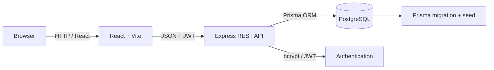
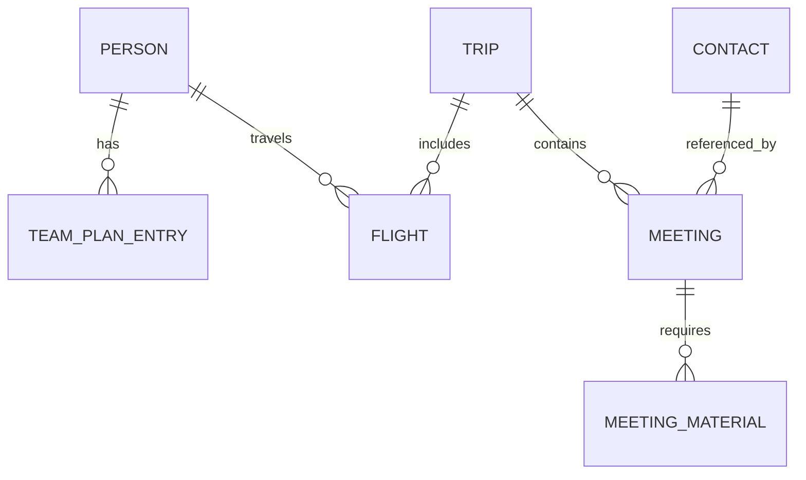

# Technical Requirements Document (TRD)

## 1. Architecture

## 2. Technology decisions

| Layer | Choice | Rationale / trade-off |
|---|---|---|
| UI | React 19 + Vite | Component model and fast local dev; requires build tooling |
| Routing | React Router | Clear module routes; small dependency |
| HTTP | Axios | Central auth header configuration; fetch would be lighter |
| API | Node.js + Express | Productive JavaScript end-to-end; fewer conventions than opinionated frameworks |
| Validation | Zod | Runtime validation at API boundary; schemas need to be maintained |
| ORM | Prisma | Typed model access and migration workflow; adds generated client dependency |
| Database | PostgreSQL 16 | Relational integrity for trips, meetings, people and materials |
| Auth | bcrypt + JWT | Simple local demo authentication; production should use refresh-token rotation/SSO and secure cookie strategy |
| Packaging | Docker Compose | Repeatable local multi-container setup; initial image build needs internet/cache |

## 3. Data model

- `User`: authenticated account, unique email, bcrypt password hash, role.
- `Person`: team member and profile metadata.
- `Trip`: destination, origin, dates, project, entity, status, hotel and transport.
- `Meeting`: child of Trip; optional Contact; agenda, priority, status, order, time and attendee names.
- `MeetingMaterial`: child of Meeting; description, owner and completion flag.
- `TeamPlanEntry`: child of Person; date range, destination, type, vacation approval and notes.
- `Contact`: city, person, organisation, title and email.
- `Flight`: optional Person and Trip references plus route/timing details.

## 4. API contract

All routes are under `/api`. Except `/health` and `/auth/login`, routes require `Authorization: Bearer <JWT>`.

| Method | Endpoint | Purpose |
|---|---|---|
| GET | `/health` | Liveness check |
| POST | `/auth/login` | Authenticate and return token |
| GET | `/dashboard` | KPI aggregate |
| GET / POST | `/trips` | List/create trips |
| DELETE | `/trips/:id` | Delete trip and cascade meetings/materials |
| POST | `/trips/:id/meetings` | Add meeting to trip |
| GET / POST | `/people` | List/create people |
| GET / POST | `/team-plan` | List/create team entries |
| PATCH | `/team-plan/:id/approval` | Update vacation decision |
| GET / POST / DELETE | `/contacts` | List/create/delete contacts |
| GET / POST | `/flights` | List/create flight segments |
| GET | `/export` | Download JSON snapshot |

Errors use HTTP status codes and a JSON `{ "error": ... }` response. Request bodies are validated with Zod. The baseline export endpoint is not a full restore/import API.

## 5. Security

- Passwords are hashed with bcrypt cost factor 12.
- JWT is signed with `JWT_SECRET`; replace the local compose value before any real deployment.
- API uses Helmet and CORS restricted to the local frontend origin.
- Protected routes verify bearer tokens.
- Request payloads are validated before writes.
- Never commit `.env`, real API keys, real travel data or production credentials.
- Production hardening still required: rate limiting, audit logs, stricter role/ownership checks, CSRF strategy if cookies are introduced, secret management, HTTPS termination, backups and retention policy.

## 6. Docker deployment topology

`docker-compose.yml` defines three services:

1. `db`: PostgreSQL 16 with a named persistent volume and health check.
2. `api`: waits for healthy DB; installs dependencies, generates Prisma client, applies migrations, seeds fictional demo data and starts Express.
3. `web`: Vite development server exposed at port 5173.

One-command startup: `docker compose up --build`.

## 7. Data consistency and concurrency

PostgreSQL is the source of truth; clients fetch persisted records from the API. This baseline does not yet implement push events or conflict resolution. A production-ready next step is optimistic concurrency using a version column and `updatedAt` preconditions, plus polling or Server-Sent Events for cross-browser refresh. Avoid last-write-wins silent overwrites.

## 8. Offline demo

The app's core flows are local after Docker images and npm packages have been pulled. Before the presentation, run `docker compose build` while internet is available and verify the laptop can start containers with networking disabled. Google Flights deep links are optional and naturally need internet.

## 9. AI / email bonus decisions

Not implemented in this baseline. If added, AI should generate a Zod-validated draft only; the user must review and explicitly save it. Keep provider keys in environment variables, record privacy constraints, and ensure all core features work when AI is disabled. Email should use a local Mailpit container for offline demonstration.
